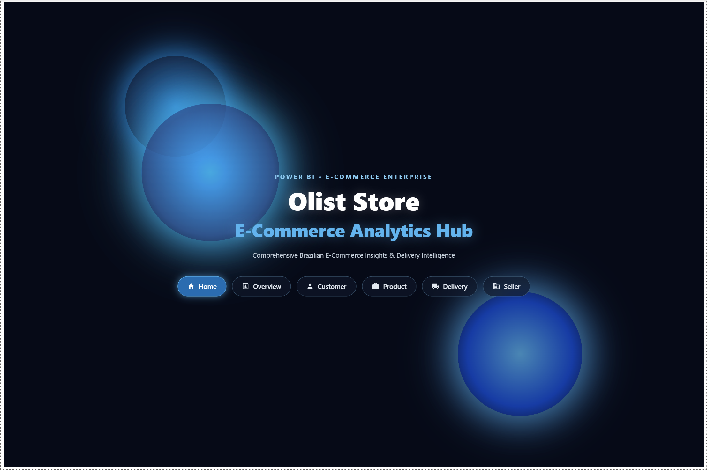
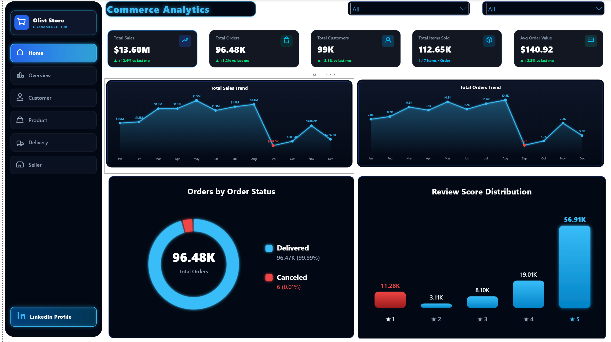
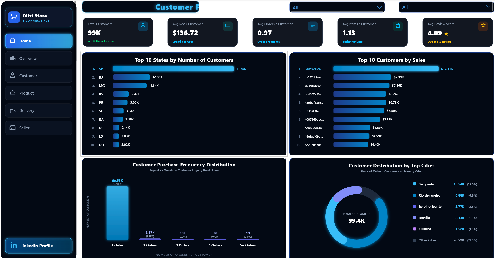
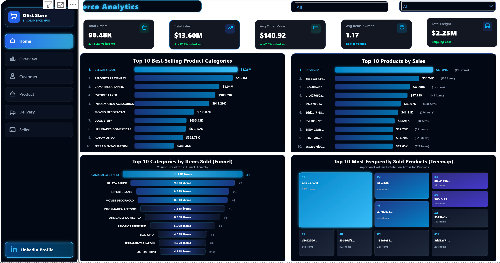
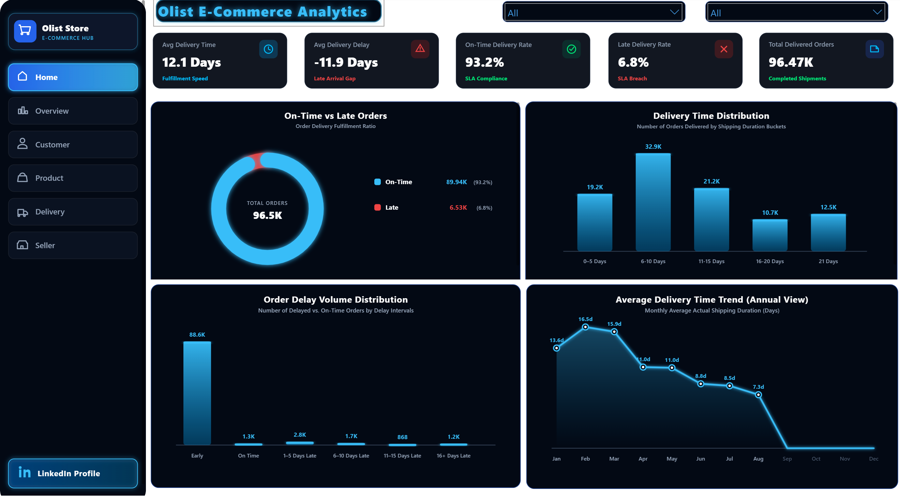
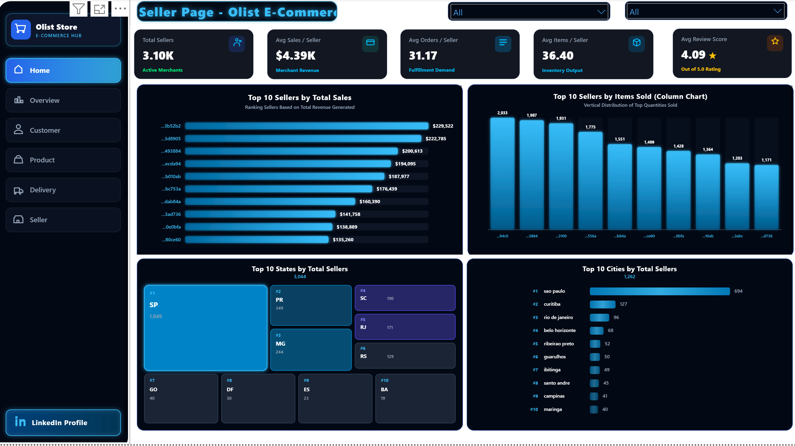

# 📊 Olist E-Commerce Analytics Hub

---

An end-to-end data analytics project examining Brazilian E-Commerce public data (Olist) to extract actionable business insights across sales performance, customer logistics, churn rate, and merchant operations.

---

## 🛠️ Tech Stack & Tools
- **Database Management:** SQL Server (Data extraction, complex aggregation, CTEs)
- **Data Processing & Cleaning:** Python (Pandas, NumPy)
- **Data Visualization & Dashboarding:** Power BI (DAX, Data Modeling, Custom Layouts)
- **UI/UX Framing:** Figma (Dashboard layout wireframing)

---

## 📸 Dashboards Overview

### 🏠 Home Dashboard

### 📈 Overview Dashboard

### 👥 Customer Dashboard

### 📦 Product Dashboard

### 🚚 Delivery Dashboard

### 🤝 Seller Dashboard

---

## 📄 التوصيات التنفيذية للبزنس | Executive Business Recommendations

### 1. تحسين استراتيجية الاحتفاظ بالعملاء ودورة حياتهم
* **الملاحظة:** نسبة تسرب العملاء (Churn) مرتفعة جداً، حيث إن **90.55 ألف عميل (أكثر من 97%)** اشتروا مرة واحدة فقط، ونسبة الشراء المكرر أقل من **3%**.
* **التوصية:** توجيه جزء من ميزانية التسويق من جلب عملاء جُدد إلى الاحتفاظ بالعملاء الحاليين (Retention). تفعيل حملات بريدية تلقائية بعد الشراء، وبرامج ولاء، وحملات إعادة إشراك بالاعتماد على تحليل RFM لتحفيز عملية الشراء الثانية وزيادة القيمة الممتدة للعميل (LTV).

---

### 2. تطوير العمليات اللوجستية والالتزام بمعايير سرعة التوصيل
* **الملاحظة:** متوسط وقت تنفيذ وشحن الطلب يستغرق **12.1 يومًا**، مع وجود **6.8% من إجمالي الطلبات (6.53 ألف طلب) تعاني من التأخير**، وتصل بعض التأخيرات إلى أكثر من 16 يومًا.
* **التوصية:** إنشاء مراكز توزيع إقليمية (Fulfillment Centers) بالقرب من المناطق ذات الطلب العالي مثل **ساو باولو (15.54 ألف عميل)** لتقليل زمن الشحن إلى أقل من 5 أيام. تطبيق سياسات صارمة لاتفاقيات مستوى الخدمة (SLA) ومحاسبة البائعين المتسببين في تأخير تجهيز الشحنات.

---

### 3. الاستفادة من المنتجات الأعلى مبيعاً والتوسع الجغرافي للبائعين
* **الملاحظة:** حجم المبيعات يتركز بشكل كبير في قطاعات رئيسية مثل (الصحة والجمال) و(أثاث ومستلزمات المنزل)، بينما يتوزع 3.10 ألف بائع نشط بشكل محلي فقط.
* **التوصية:** التركيز على توفير المخزون واستراتيجيات الترويج للأقسام الأكثر مبيعاً ونشاطاً. العمل على جذب وبناء شراكات مع بائعين جُدد في المناطق الجغرافية ذات الطلب العالي لتقليل تكاليف الشحن بين الولايات وتفادي اختناقات التوصيل.

---

### 4. معالجة مشاكل الخدمة والتعامل السريع مع التقييمات السلبية
* **الملاحظة:** هناك جزء غير هين من التقييمات يقع في فئات الرضا المنخفضة، بما في ذلك **11.28 ألف تقييم بنجمة واحدة**، على الرغم من أن متوسط التقييم العام جيد ويبلغ 4.09.
* **التوصية:** إجراء تحليل متقدم للنصوص واللغة (NLP) وتحليل المشاعر على تعليقات العملاء السلبية لتحديد الأسباب الجذرية (مثل جودة المنتج مقابل تأخير الشحن). تنفيذ نظام تنبيه تلقائي للتقييمات السيئة لتمكين خدمة العملاء من التدخل السريع.

---

### 👤 Created By:
**Ebrahim Mustafa** — *Data Analyst & BI Analyst*
